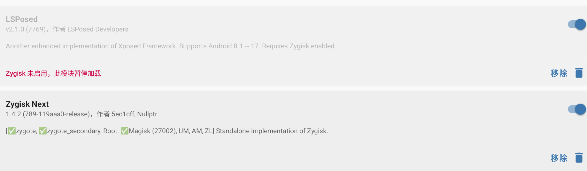
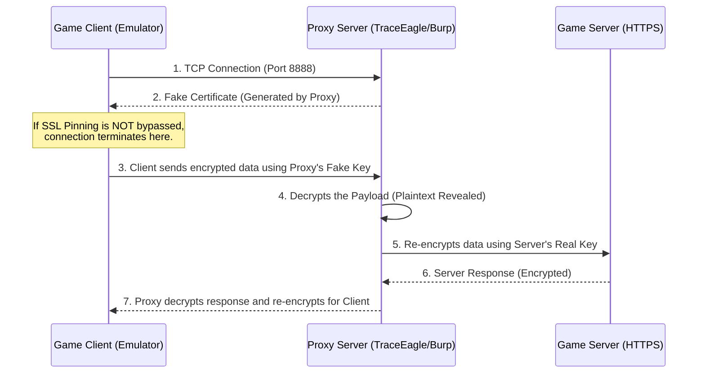

# 📱 Android Game Network Protocol Analysis & Reversing Notes

This repository documents a hands-on journey of reverse-engineering a mobile game (built on a custom C++ engine). It covers the complete workflow from bypassing environment detection (Root/anti-debugging) and SSL Pinning, to distinguishing between proxy-based and raw NIC packet capture, and ultimately analyzing custom TCP protocols.

> ⚠️ **Disclaimer**: This project is for educational and cybersecurity research purposes only. All sensitive information (e.g., real IP addresses, Session Tokens, account credentials) has been sanitized. Do not use these techniques for cheating or any illegal activities.

---

## 1. Initial Troubleshooting & Capture Limitations

### 1.1 First Attempt: App-Layer Injection (Failed)
To understand the game's logic, the first logical step was to use an App-layer capture tool (which injects a hook into the target process to intercept Socket APIs directly).

<div align="center">
  
</div>
*   **Symptom**:
    *   When attempting to hook the game by **restarting the target app** (`Restart Target App` enabled), the client would instantly freeze on a black screen and refuse to launch. This indicated that the injection process itself was detected during the early startup phase.
    *   When attempting to attach to the **already running process** (without restarting), the injection failed entirely, returning an error (`target_app_not_running`). The game's anti-debugging module actively blocked the hooking attempt.

 <div align="center">
  
</div>

*   **Analysis**: The game employs robust anti-debugging and anti-injection mechanisms. Upon launching, it scans its own process memory. Detecting the injected capture module (e.g., Frida agent), the game triggered a self-protection routine and terminated itself.

### 1.2 Second Attempt: Raw NIC Capture (Successful but Limited)
Since the process rejected injection, the next approach was **Raw NIC (Network Interface Card) Capture** (Data Link/Network layer). By putting the virtual NIC into Promiscuous Mode, we bypassed the API level entirely.

*   **Result**: We successfully intercepted raw TCP/IP traffic (specifically on Port `22158`). We discovered the game used a long-polling raw TCP connection instead of standard HTTP.
*   **Limitation**: Raw capture provides the "what" (the raw bytes), but not the "meaning". While unencrypted custom text protocols (like Heartbeats) were readable, critical business logic packets appeared only as unreadable ciphertext. The packet header started with `78 9C` (a Zlib compression header), but attempts to decompress failed (`unsupported compression method`). This indicated the data was **first Zlib-compressed, then wrapped in an additional layer of AES or custom encryption**.

*   **Some readable information**：Heartbeat and Attack information.
<div align="center">
  
  
</div>

*   **Some of them are absolutely not readable**: 
 <div align="center">
  
</div>

### 1.3 Third Attempt: System HTTP Proxy (The Breakthrough)
Since we couldn't decrypt the custom protocol immediately, we analyzed the traffic fingerprint and found that the game mixed network architectures. Certain APIs (like Login and Recharge) actually used standard HTTPS.

*   **Problem**: Configuring a system HTTP proxy (e.g., `Burp Suite` or `TraceEagle` in Proxy Mode) resulted in "Network Connection Error". The game implemented **SSL Pinning**, refusing to trust the user-installed CA certificate.
*   **Conclusion**: To see the plaintext of these HTTPS requests, we had to build a heavily modified, stealthy Root environment to bypass SSL Pinning (detailed in Section 2).

---

## 2. Environment Setup & Anti-Detection Bypass

To perform App-layer injection and bypass SSL Pinning, standard Root privileges are insufficient. The game employs multi-layered environmental checks (Root detection, emulator detection, and integrity checks). We had to construct a stealthy, systemless Root environment on an Android 14 emulator.

### 2.1 Bypassing Root & Injection Detection (Kitsune Mask + Zygisk Next)
*   **The Problem**: The game scans its own process memory and system files for traces of `su` and known debugging frameworks. Using the emulator's built-in Root caused the App-layer capture tool to trigger an immediate black screen and crash during injection.
*   **The Solution**:
    1.  **Systemless Root**: Abandoned the crude built-in Root. Flashed **Kitsune Mask (Magisk Delta)** via recovery. This provides a more covert Root environment.
    2.  **Zygisk Replacement**: Disabled the built-in Zygisk (which has known signatures) and deployed **Zygisk Next**. This provides a stealthier injection mechanism, preventing the game from detecting the Zygisk environment itself.
    3.  **Configuring the Routing (KSU WebUI)**: Used **KSU WebUI** to manage the Zygisk Next settings. Enabled "Anonymous Memory" to hide the injected modules from memory scans.
    4.  **DenyList Enforcement**: Added the target game package to the Magisk DenyList. This prevents the game from seeing the Root environment and the injected Xposed/LSPosed frameworks during its initial integrity check.
*   **The Outcome**: Despite the heavy stealth setup, the game's anti-injection mechanism was still too aggressive. When the App-layer capture tool attempted to attach to the running process, the game detected the hook and killed itself (`target_app_not_running`). We had to abandon App-layer injection and switch to Raw NIC capture.
 <div align="center">
  
</div>
### 2.2 Bypassing SSL Pinning (LSPosed + TrustMeAlready)
Even with a stealth Root environment, the HTTP Proxy mode failed in log-in process because the game implemented **SSL Pinning**. The client strictly validates the server's certificate fingerprint and refuses to trust user-installed CA certificates.

*   **The Solution**:
    1.  Flashed the **LSPosed** framework (activated via Zygisk Next. Although the stealth environment failed to fully bypass the anti-injection protection, it became the perfect foundation for fixing the **SSL Pinning** issue we encountered later during HTTP Proxy capture. ).
    2.  Installed the LSPosed module **TrustMeAlready**.
    3.  Scoped the module strictly to the target game package. This module hooks low-level Java APIs (e.g., `javax.net.ssl.SSLContext` and `OkHttp` certificate checkers) and forces them to return `true`, effectively disabling certificate validation.
*   **Validation**: We successfully captured the plaintext JSON payload for Login, Recharge, and Inventory synchronization via the HTTP Proxy.

### 2.3 Resolving Proxy Conflicts (The "Target App Not Running" Error)
*   **The Problem**: While testing the App-layer capture tool with the stealth environment active, an error `target_app_not_running` occurred.
*   **The Root Cause**: The injection tool attempted to hook the app during its startup phase. The game's anti-injection module detected the hook attempt and immediately killed the process.
*   **The Workaround**: We bypassed the instant-launch injection. Instead of hooking the app at startup, we let the game fully load to the login screen, then manually triggered the App-layer capture. With the Kitsune Mask DenyList and Zygisk Next active, the game failed to detect the late-stage injection, allowing us to intercept the Socket traffic successfully.

---

## 3. Packet Capture: Raw NIC Mode & TCP Reassembly

Since the App-layer injection was terminated by the game's anti-cheat, and the HTTP Proxy could only intercept standard HTTPS traffic, we switched to **Raw NIC (Network Interface Card) Capture** to intercept the underlying raw TCP traffic.

### 3.1 Traffic Fingerprinting & Port Identification
Initial raw captures were flooded with `mDNS` and `ICMP` background noise. By applying filtering rules and tracing DNS resolutions, we isolated the core game traffic:

*   **Persistent Destination IP**: The client maintained a long-lived connection to a specific IP (redacted for privacy).
*   **Port Signature**: The traffic was heavily concentrated on **Port `22158`**. 
*   **Protocol**: The traffic is pure raw TCP, not wrapped in HTTP/2 or WebSocket. This explains why the HTTP Proxy failed to capture it.

### 3.2 TCP Stream Reassembly & Heartbeat Analysis
By filtering the capture with `tcp.port == 22158`, we observed a distinct communication pattern:

1.  **Heartbeat Mechanism**: Every ~10 seconds, the client and server exchanged extremely small payloads (around 16 bytes).
2.  **Custom Text Protocol**: By extracting the raw TCP Payload and converting it from Hex to ASCII, a surprising discovery was made. The game **uses a custom, HTTP-like text protocol**. Despite running over raw TCP, the payload mimics a URL-encoded format:

### 3.3 Payload Extraction & JSON Transformation

While the heartbeat packet was simple, capturing the actual battle and reward data resulted in massive Hex dumps (`attack.bin`, `pet_update.bin`). These raw files contained a mix of Ethernet headers, IP/TCP headers, and application-layer payloads. 

To make sense of the data, we built a Python-based data extraction pipeline to transform these messy raw Hex dumps into structured JSON.

##### 1. The Data Cleaning Challenge
Exporting the raw Hex to text introduced several issues:
*   **Encoding Traps**: The text files were saved in UTF-16 (common with Windows/PowerShell), filling the file with invisible null characters (`\x00`) between every letter.
*   **Visual Noise**: The Hex dumps contained memory offset addresses on the left (`00000000`) and ASCII character previews on the right (`RT..5..`), which polluted the regex parsing.
*   **URL Encoding**: The actual application data was wrapped in standard URL percent-encoding (e.g., `%22`, `%7B`).

##### 2. Python Extraction Script
We wrote a script (`hex_to_json.py`) to automate the extraction. The core logic involves:
1.  Stripping all `\x00` null bytes to fix encoding issues.
2.  Using Regex (`\b[0-9A-Fa-f]{2}\b`) to vacuum up valid 2-byte hex pairs, ignoring the addresses and ASCII noise.
3.  Decoding the Hex stream to ASCII, locating the `bv=` signature to drop the TCP headers.
4.  Using `urllib.parse.unquote` to decode the URL-encoded string and `json.loads()` to format it perfectly.

#### 3. Decode to JSON
raw_text = bytes.fromhex(hex_string).decode('ascii', errors='ignore')
payload_str = raw_text[raw_text.find('bv='):]
decoded_payload = urllib.parse.unquote(payload_str)
## For example：
```json
[
    {
        "fightInfo": {
            "actionList": [
                {
                    "actionPara": [],
                    "resultList": [],
                    "round": 0,
                    "skillId": 0,
                    "sourceId": 0
                },
                {
                    "actionPara": [],
                    "resultList": [],
                    "round": 1,
                    "skillId": 11,
                    "sourceId": 0
                },
                {
                    "actionPara": [],
                    "resultList": [],
                    "round": 3,
                    "skillId": 204611,
                    "sourceId": 102020461
                },
                {
                    "actionPara": [],
                    "resultList": [],
                    "round": 4,
                    "skillId": 12,
                    "sourceId": 0
                },


```

---

## 4. MITM Proxy Configuration & SSL Pinning Bypass

While raw NIC capture allowed us to see the raw TCP streams, decrypting standard HTTPS traffic (like login and recharge) required setting up an HTTP Proxy (Man-in-the-Middle).

### 1. Emulator Network Configuration
To route the emulator's traffic through the proxy tool (e.g., TraceEagle or Burp Suite) on the host PC:
1.  In the emulator's Android settings, navigate to **Network & Internet -> Wi-Fi**.
2.  Modify the connected Wi-Fi network (e.g., `WiredSSID`).
3.  Change the Proxy settings from `None` to `Manual`.
4.  Set the **Proxy hostname** to the host PC's local IPv4 address (e.g., `192.168.x.x`) and the **Proxy port** to the port configured in the proxy tool (e.g., `8888`).
To verify and clear the proxy when done:
```shell
adb shell settings put global http_proxy :0
```

### 2. The MITM Certificate Mechanism
Even with the proxy configured, the game uses HTTPS. The proxy acts as a "Man-in-the-Middle" to decrypt the traffic. However, the game strictly verifies the server's certificate (SSL Pinning), rejecting the proxy's fake certificate. 

The diagram below illustrates the MITM interception process:




